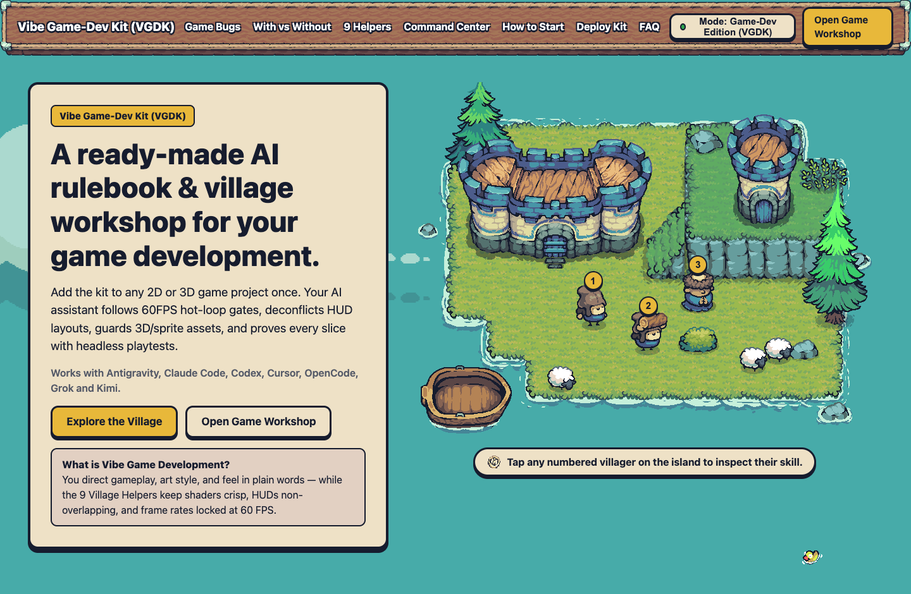
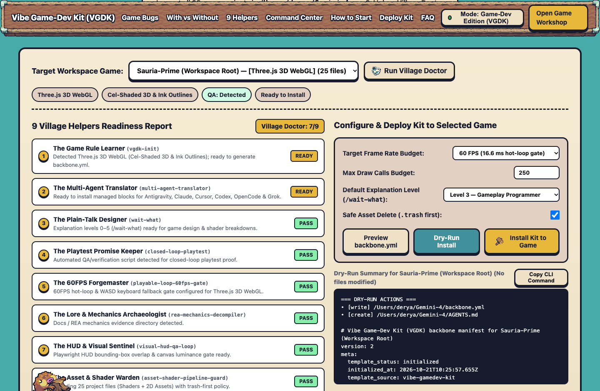
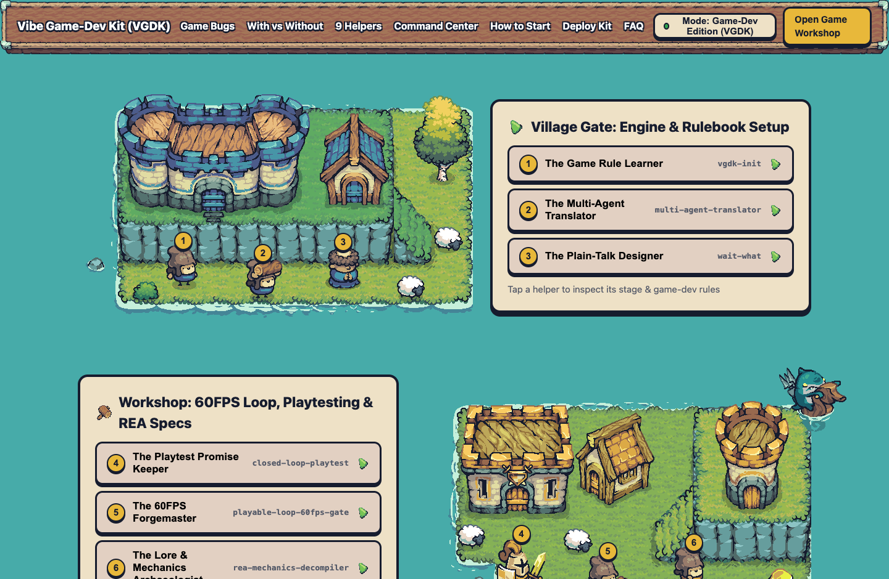
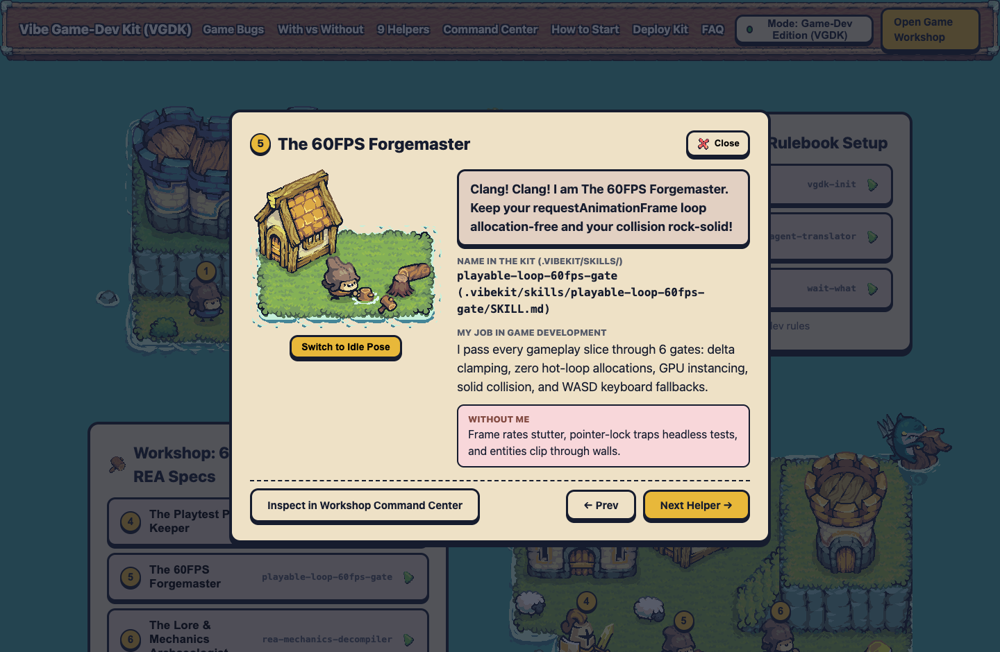

# Vibe Game-Dev Kit (VGDK) — v0.1

**AI Game-Development Rulebook, 9 Village Helpers, 4 Specialist Game-Dev Skills, and Interactive 2D Pixel-Art Island Command Center.**

Cloned and evolved from [`camera.ai.vn`](https://camera.ai.vn/) ([`minimal-vibe-coding-kit`](https://github.com/giang6283623/minimal-vibe-coding-kit)) for 2D & 3D game development workflows across **Antigravity (`.agent/`)**, **Claude Code (`.claude/`)**, **Cursor (`.cursor/`)**, **Codex (`.agents/`)**, **OpenCode**, and **Grok (`.grok/`)**.



---

## Highlights in v0.1

1. **Interactive 2D Floating-Island Village & Live Game-Dev Command Center (`public/`)**:
   - **Nearest-Neighbor HTML5 2D Island Renderer (`public/src/island-canvas.js`)**: Renders animated 16-frame `192×192` shoreline water foam (`terrain-tileset-water-foam.png`), 11 pixel-art floating islands, 42 Y-sorted animated sprite strips (villagers, warriors, archers, lancers, monks, sheep, boats, trees, goblins, trolls, spiders, gnolls, skulls, fire FX, and the patrolling **Pig Button Guard**), 36 talk & sea-pest animations, and 11 character stages.
   - **Live Game-Dev Command Center (`#workshop-center`)**: Scans workspace game projects, runs a 9-Helper **Village Doctor** readiness audit, previews tailored `backbone.yml` + `AGENTS.md` files, and supports 1-click **Dry-Run** or **Live Installation** into any game repository.
   - **Dual-Mode Switcher**: Switch live between **Game-Dev Edition (VGDK)** and **Classic Camera.ai.vn (MVCK)**.



2. **The 9 Game-Dev Village Helpers & 4 Specialist Skills (`.vibekit/skills/`)**:
   - **District 1 — Village Gate (Setup)**:
     - `#1` **The Game Rule Learner (`vgdk-init`)**: Auto-detects engine (`Three.js 3D WebGL`, `Canvas2D / HTML5`, `PixiJS`, `Phaser 2D`), art style, and controls to generate `backbone.yml`.
     - `#2` **The Multi-Agent Translator (`multi-agent-translator`)**: Mirrors the rulebook and skills across Antigravity, Claude Code, Cursor, Codex, OpenCode, and Grok using non-destructive managed blocks.
     - `#3` **The Plain-Talk Designer (`wait-what`)**: Re-explains complex shader derivatives, Catmull-Rom lofting, or ECS state machines at explanation levels `0–5`.
   - **District 2 — Workshop (Playable Loop, 60FPS & REA)**:
     - `#4` **The Playtest Promise Keeper (`closed-loop-playtest`)**: Requires headless visual + zero-console-error proof before marking any vertical slice "done".
     - `#5` **The 60FPS Forgemaster (`playable-loop-60fps-gate`)**: Enforces 6 quality gates (`dt` clamping, zero hot-loop allocations, GPU instancing, solid collision, and `WASD` keyboard fallbacks when PointerLock is inactive).
     - `#6` **The Lore & Mechanics Archaeologist (`rea-mechanics-decompiler`)**: Extracts reference game systems, XP curves, and combat/building loops via REA into `docs/rea_<feature>_report.json`.
   - **District 3 — Walls (Visual/HUD QA, Assets & Review)**:
     - `#7` **The HUD & Visual Sentinel (`visual-hud-qa-loop`)**: Scores the `0–6` Visual Gate and checks DOM bounding boxes so HUD panels never overlap the center crosshair or playfield.
     - `#8` **The Asset & Shader Warden (`asset-shader-pipeline-guard`)**: Validates `.glb` bounds, sprite-sheet frame math (`frameW × frames === width`), `fwidth()` analytical shader anti-aliasing, and `.trash`-first asset deletion.
     - `#9` **The Playtest Reviewer (`reviewing-4p-priorities`)**: Audits gameplay and rendering diffs from `P0` (boot crash / black screen) to `P4` (juice & polish).





---

## Quick Start

### 1. Start the Interactive Island Village & Command Center
```bash
npm start
# Open http://127.0.0.1:4175
```

### 2. CLI Commands (`bin/vgdk.mjs`)
```bash
# Scan a game development workspace for projects:
node bin/vgdk.mjs scan /path/to/workspace

# Run the 9-Helper Village Doctor on a target game:
node bin/vgdk.mjs doctor /path/to/game

# Preview (dry-run) or install backbone.yml, AGENTS.md, and .vibekit/skills into a game:
node bin/vgdk.mjs install /path/to/game --dry-run
node bin/vgdk.mjs install /path/to/game
```

### 3. Verify Assets & Run Automated Headless QA
```bash
npm run mirror:verify
npm run qa
```

---

## Credits & Upstream Attribution

- Upstream concept & open-source kit architecture: [Minimal Vibe Coding Kit](https://github.com/giang6283623/minimal-vibe-coding-kit) (`camera.ai.vn`) by Bui Van Giang (MIT License).
- Pixel art illustrations: **Tiny Swords** by Pixel Frog.
